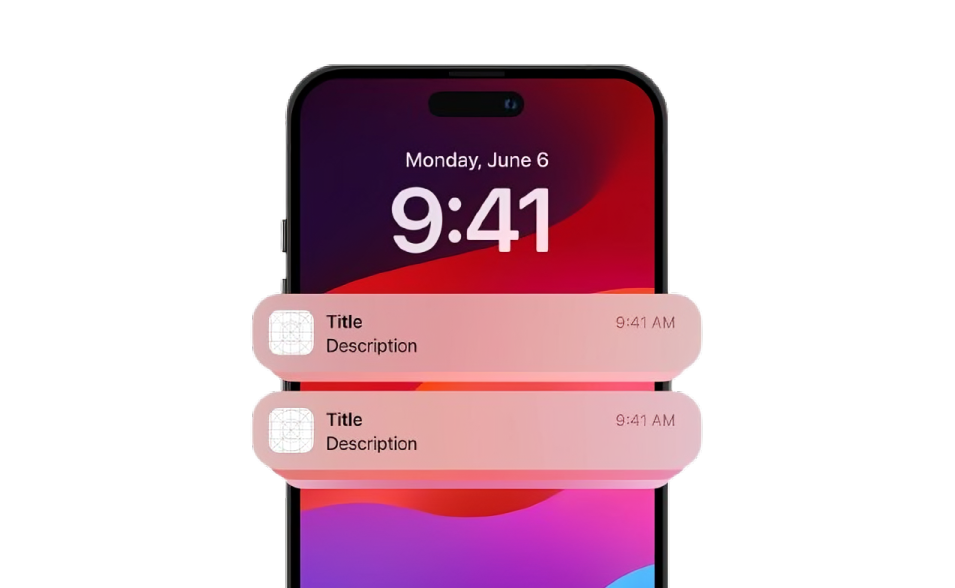

<div align="center">
  
</div>

<div align="center">

# Push Notification System

A full-stack web push notification application built with Next.js and Node.js.


</div>

---

## Features

- Browser push notification subscription management
- Notification permission and support detection
- Service worker registration and lifecycle handling
- Subscribe and unsubscribe actions
- Broadcast notifications to every registered subscription
- Configurable notification title, message, icon, and destination link
- Accessible loading, success, and error feedback
- PWA manifest and service worker support
- Docker support for the Next.js client

## Tech Stack

### Client

- Next.js 15.5.6
- React 19.1.0
- TypeScript
- Tailwind CSS 4
- Web Push and Service Workers API

### Server

- Node.js
- Express
- `web-push`
- CORS
- `dotenv`

## Project Structure

```text
push-notification/
├── backend/
│   ├── utils/
│   │   └── PushNotificationManager.js
│   ├── example.env
│   ├── package.json
│   └── server.js
├── client/
│   ├── public/
│   │   ├── manifest.json
│   │   ├── sw.js
│   │   └── vercel.svg
│   ├── src/
│   │   ├── app/
│   │   │   ├── globals.css
│   │   │   ├── layout.tsx
│   │   │   └── page.tsx
│   │   ├── features/
│   │   │   └── notifications/
│   │   │       ├── components/
│   │   │       │   ├── PushNotificationManager.tsx
│   │   │       │   └── SendNotificationForm.tsx
│   │   │       └── lib/
│   │   │           ├── notification-api.ts
│   │   │           └── push-notifications.ts
│   │   └── types/
│   │       └── styles.d.ts
│   ├── Dockerfile
│   ├── example.env
│   ├── next.config.ts
│   └── package.json
├── demo.png
└── README.md
```

## Installation

### 1. Generate VAPID Keys

```bash
npx web-push generate-vapid-keys
```

Save the generated public and private keys. The public key is used by both the client and server.

### 2. Configure the Server

```bash
cd backend
npm install
cp example.env .env
```

Set the values in `backend/.env`:

```env
VAPID_PUBLIC_KEY=your-public-key
VAPID_PRIVATE_KEY=your-private-key
VAPID_SUBJECT=mailto:your-email@example.com
PORT=4000
```

### 3. Configure the Client

```bash
cd ../client
npm install
cp example.env .env.local
```

Set the values in `client/.env.local`:

```env
NEXT_PUBLIC_VAPID_PUBLIC_KEY=your-public-key
NEXT_PUBLIC_SERVER_URL=http://localhost:4000
```

Do not use the private VAPID key in the client.

## Running Locally

Start the backend:

```bash
cd backend
npm run dev
```

The API will run at `http://localhost:4000`.

In a separate terminal, start the client:

```bash
cd client
npm run dev
```

Open `http://localhost:3000`.

## Client Behavior

The client is organized under `client/src/features/notifications`.

- `PushNotificationManager.tsx` registers `/sw.js`, requests notification permission, creates or retrieves the browser push subscription, and sends it to the server.
- `push-notifications.ts` contains browser support checks, service worker registration, permission requests, subscription creation, and unsubscribe helpers.
- `notification-api.ts` communicates with the Express API and validates broadcast responses.
- `SendNotificationForm.tsx` sends a broadcast containing title, message, icon URL, and destination URL.

The subscription manager displays the current browser permission and active subscription status. When the browser rejects permission or the server request fails, the UI shows an accessible error message.

## API

All API requests use the base URL from `NEXT_PUBLIC_SERVER_URL`.

### Server status

```http
GET /
```

### Subscribe

```http
POST /api/subscribe
Content-Type: application/json
```

The request body is the browser `PushSubscription` object.

### Unsubscribe

```http
POST /api/unsubscribe
Content-Type: application/json
```

### Send to one endpoint

```http
POST /api/send-notification
Content-Type: application/json
```

```json
{
  "endpoint": "https://push-service.example/subscription",
  "title": "Hello",
  "body": "This is a test notification",
  "icon": "/next.svg",
  "url": "/"
}
```

### Broadcast

```http
POST /api/broadcast
Content-Type: application/json
```

```json
{
  "title": "Announcement",
  "body": "This notification is for every subscriber",
  "icon": "/next.svg",
  "url": "/"
}
```

### List subscriptions

```http
GET /api/subscriptions
```

## Docker

Build the client image:

```bash
docker build \
  --build-arg NEXT_PUBLIC_VAPID_PUBLIC_KEY=your-public-key \
  --build-arg NEXT_PUBLIC_SERVER_URL=http://localhost:4000 \
  -t push-notification-client \
  ./client
```

Run the client:

```bash
docker run --rm -p 3000:3000 push-notification-client
```

Because Next.js public environment variables are included in the client build, rebuild the image whenever these values change.

## Testing the Notification Flow

1. Start the backend and client.
2. Open `http://localhost:3000` in a browser that supports Web Push.
3. Allow notification permission.
4. Click **Enable notifications**.
5. Enter a title and message in the send notification form.
6. Optionally set an icon URL and destination link.
7. Click **Send**.

The server keeps subscriptions in memory. Restarting the server clears all subscriptions.

## Browser Notes

- Notification push requires HTTPS in production.
- `localhost` is generally treated as a secure context for local development.
- Safari and other browsers may require PWA installation or additional platform support.
- Notification permission must be allowed for the browser site.

## Troubleshooting

### Notifications are not supported

- Use a supported browser.
- Confirm that the site is running over HTTPS or localhost.
- Check that the browser exposes `serviceWorker`, `PushManager`, and `Notification`.

### Permission stays denied

Reset notification permission in the browser site settings, then reload and retry.

### Subscription is not working

- Confirm `NEXT_PUBLIC_VAPID_PUBLIC_KEY` matches `VAPID_PUBLIC_KEY`.
- Confirm `NEXT_PUBLIC_SERVER_URL` points to the running backend.
- Open DevTools → Application → Service Workers and verify `/sw.js` is activated.
- Restart the backend if in-memory subscriptions were cleared.

### Broadcast returns no users subscribed

Enable notifications in the browser so the subscription is posted to `/api/subscribe`.

---

<div align="center">
  <p>Built with Next.js and Node.js</p>
</div>
