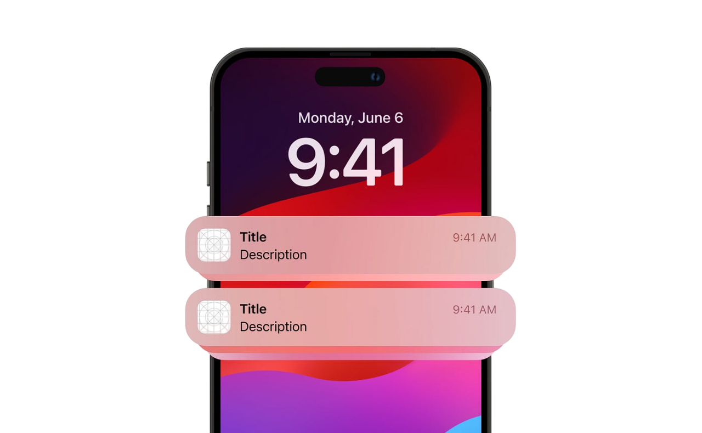

<div align="center">
 
</div>

<div align="center">

# 🔔 Push Notification System

A modern, full-stack push notification system built with **Next.js 15** and **Node.js**. This project demonstrates how to implement web push notifications with service workers, VAPID authentication, and a beautiful UI.


</div>

## ✨ Features

- 🔔 **Push Notifications** - Real-time web push notifications using Web Push API
- 🔐 **VAPID Authentication** - Secure authentication with VAPID keys
- 👥 **Subscription Management** - Subscribe/Unsubscribe functionality
- 📤 **Broadcast Messaging** - Send notifications to all subscribed users
- 🎯 **Targeted Notifications** - Send to specific users by endpoint
- 🔍 **Debug Panel** - System status monitoring for troubleshooting
- 📱 **Progressive Web App** - PWA support with manifest and service worker
- ⚡ **Real-time Updates** - Instant notification delivery
- 🎭 **Customizable** - Custom icons, titles, bodies, and action URLs

---

## 🛠️ Tech Stack

### Frontend (Client)
- **Next.js 15.5.6** - React framework with Turbopack
- **React 19.1.0** - UI library
- **TypeScript** - Type safety
- **TailwindCSS 4.x** - Utility-first CSS framework
- **Service Workers** - Background sync and push notifications

### Backend (Server)
- **Node.js** - JavaScript runtime
- **Express.js** - Web framework
- **web-push** - Web push protocol library
- **CORS** - Cross-origin resource sharing
- **dotenv** - Environment variable management

---

## 📁 Project Structure

```
push-notification-nextjs/
├── backend/                    # Node.js backend server
│   ├── utils/
│   │   └── PushNotificationManager.js   # Push notification logic
│   ├── server.js              # Express server
│   ├── generate-vapid.js      # VAPID key generator
│   ├── example.env            # Environment variables template
│   └── package.json           # Backend dependencies
│
├── client/                    # Next.js frontend
│   ├── src/
│   │   ├── app/
│   │   │   ├── page.tsx       # Home page
│   │   │   ├── layout.tsx     # Root layout
│   │   │   └── globals.css    # Global styles
│   │   ├── components/
│   │   │   ├── PushNotificationManager.tsx    # Subscription UI
│   │   │   ├── SendNotificationForm.tsx       # Send notification form
│   │   │   └── DebugPanel.tsx                 # Debug panel
│   │   └── utils/
│   │       └── notification.ts                # Notification utilities
│   ├── public/
│   │   ├── sw.js              # Service worker
│   │   └── manifest.json      # PWA manifest
│   ├── example.env            # Environment variables template
│   └── package.json           # Frontend dependencies
│
└── README.md                  # This file
```

---

## 📋 Prerequisites

Before you begin, ensure you have the following installed:

- **Node.js** (v18 or higher) - [Download](https://nodejs.org/)
- **npm** or **yarn** - Package manager
- A modern browser (Chrome, Firefox, Edge, Safari)
- HTTPS or localhost (required for service workers)

---

## 🚀 Installation & Setup

### 1️⃣ Clone the Repository

```bash
git clone https://github.com/sadegh1379/push-notification.git
cd push-notification-nextjs
```

### 2️⃣ Backend Setup

```bash
# Navigate to backend directory
cd backend

# Install dependencies
npm install

# Generate VAPID keys
web-push generate-vapid-keys

# Copy example.env to .env
cp example.env .env
```

**Edit `backend/.env` file:**
```env
VAPID_PUBLIC_KEY=<your-generated-public-key>
VAPID_PRIVATE_KEY=<your-generated-private-key>
VAPID_SUBJECT=mailto:your-email@example.com
PORT=4000
```

### 3️⃣ Frontend Setup

```bash
# Navigate to client directory
cd ../client

# Install dependencies
npm install

# Copy example.env to .env.local
cp example.env .env.local
```

**Edit `client/.env.local` file:**
```env
NEXT_PUBLIC_VAPID_PUBLIC_KEY=<your-generated-public-key>
NEXT_PUBLIC_SERVER_URL=http://localhost:4000
```

> ⚠️ **Important:** Use the same VAPID public key in both backend and frontend!

---

## 🎯 Running the Application

### Start Backend Server

```bash
cd backend
npm run dev
```

The server will start at `http://localhost:4000`

### Start Frontend Client

```bash
cd client
npm run dev
```

The app will be available at `http://localhost:3000`

---

## 📚 API Documentation

### Base URL
```
http://localhost:4000
```

### Endpoints

#### 1. **Server Status**
```http
GET /
```

#### 2. **Subscribe User**
```http
POST /api/subscribe
Content-Type: application/json

{
  "endpoint": "https://...",
  "keys": {
    "p256dh": "...",
    "auth": "..."
  }
}
```
#### 3. **Unsubscribe User**
```http
POST /api/unsubscribe
Content-Type: application/json

{
  "endpoint": "https://..."
}
```

#### 4. **Send Notification to Specific User**
```http
POST /api/send-notification
Content-Type: application/json

{
  "endpoint": "https://...",
  "title": "Hello!",
  "body": "This is a test notification",
  "icon": "/next.svg",
  "url": "/"
}
```

#### 5. **Broadcast to All Users**
```http
POST /api/broadcast
Content-Type: application/json

{
  "title": "Announcement",
  "body": "This goes to everyone!",
  "icon": "/next.svg",
  "url": "/"
}
```

#### 6. **Get All Subscriptions**
```http
GET /api/subscriptions
```

---

## 🔍 How It Works

### 1. **Service Worker Registration**
The client registers a service worker (`sw.js`) that runs in the background and listens for push events.

### 2. **Requesting Permission**
When users click "Subscribe", the app requests notification permission from the browser.

### 3. **Creating Subscription**
If permission is granted, the browser creates a push subscription with the VAPID public key.

### 4. **Sending to Server**
The subscription object is sent to the backend server and stored in memory.

### 5. **Sending Notifications**
The server uses the `web-push` library to send notifications to subscribed endpoints.

### 6. **Receiving Notifications**
The service worker receives the push event and displays the notification to the user.

---

## 🔐 Environment Variables

### Backend (`.env`)
| Variable | Description | Example |
|----------|-------------|---------|
| `VAPID_PUBLIC_KEY` | VAPID public key | `BHxT...` |
| `VAPID_PRIVATE_KEY` | VAPID private key | `kj3k...` |
| `VAPID_SUBJECT` | Contact information | `mailto:admin@example.com` |
| `PORT` | Server port | `4000` |

### Frontend (`.env`)
| Variable | Description | Example |
|----------|-------------|---------|
| `NEXT_PUBLIC_VAPID_PUBLIC_KEY` | VAPID public key (must match backend) | `BHxT...` |
| `NEXT_PUBLIC_SERVER_URL` | Backend server URL | `http://localhost:4000` |

---

## 🧪 Testing

### Test on Localhost

1. Open `http://localhost:3000` in your browser
2. Click **"Subscribe to Notifications"**
3. Allow notification permission
4. Fill in the notification form:
   - Title: "Test Notification"
   - Body: "Hello from localhost!"
5. Click **"Send Notification"**
6. You should receive a notification!

### Test on Mobile/Other Devices

For testing on mobile devices or other computers:

1. Use **ngrok** to expose your localhost:
   ```bash
   npx ngrok http 3000
   ```

2. Update `.env.local` with the ngrok URL:
   ```env
   NEXT_PUBLIC_SERVER_URL=https://your-ngrok-url.ngrok.io
   ```

3. Open the ngrok URL on your device

> 📱 **Note:** HTTPS is required for push notifications on production domains.

---

## 🐛 Troubleshooting

### Notifications Not Working?

1. **Check Browser Support**
   - Chrome, Firefox, Edge ✅
   - Safari 16+ ✅
   - Private/Incognito mode ❌

2. **Check Permissions**
   - Browser notification permission must be "Allow"
   - Check browser's site settings

3. **Check Service Worker**
   - Open DevTools → Application → Service Workers
   - Ensure service worker is activated

4. **Check VAPID Keys**
   - Both backend and frontend must use the same public key
   - Keys must be properly formatted

5. **Check Server**
   - Backend server must be running on port 4000
   - Check console for errors

6. **Hard Refresh**
   - Press `Ctrl+Shift+R` (Windows) or `Cmd+Shift+R` (Mac)
   - Clear service worker cache if needed

---

## 📱 Progressive Web App (PWA)

This project includes PWA support:

- **manifest.json** - App metadata and icons
- **Service Worker** - Offline capability and push notifications
- **Installable** - Can be installed on home screen

---

## 📝 Scripts

### Backend
```bash
npm start       # Start server (production)
npm run dev     # Start server with auto-reload (development)
```

### Frontend
```bash
npm run dev     # Start Next.js dev server with Turbopack
npm run build   # Build for production
npm start       # Start production server
npm run ngrok   # Expose localhost via ngrok
```

---

<div align="center">
  <p>Made with ❤️ using Next.js and Node.js</p>
  <p>⭐ Star this repo if you find it helpful!</p>
</div>

